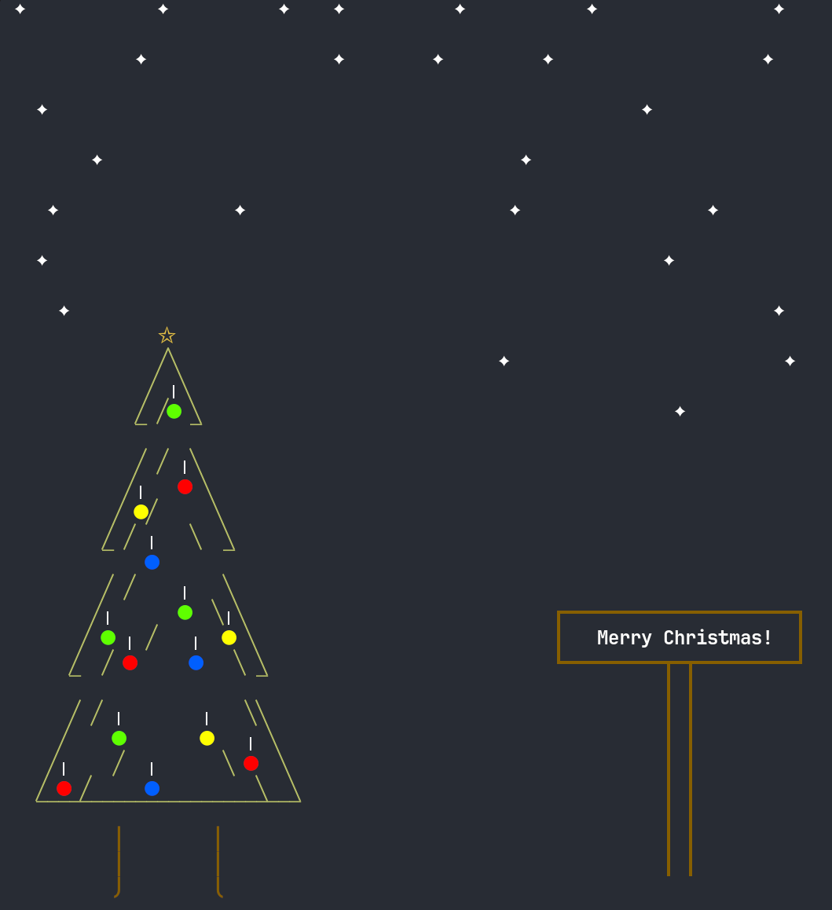

# rusty-tree

Christmas tree in the Terminal!

Print a Christmas tree with animated decoration and a randomly changing night sky!

Using Rust and UTF-8 character set.



## Usage

1. Clone the repo

2. Run the release version using cargo:

   ```bash
     cargo run --release
   ```

3. Exit the program using `CTRL + C`

## License

[MIT License](LICENSE)
